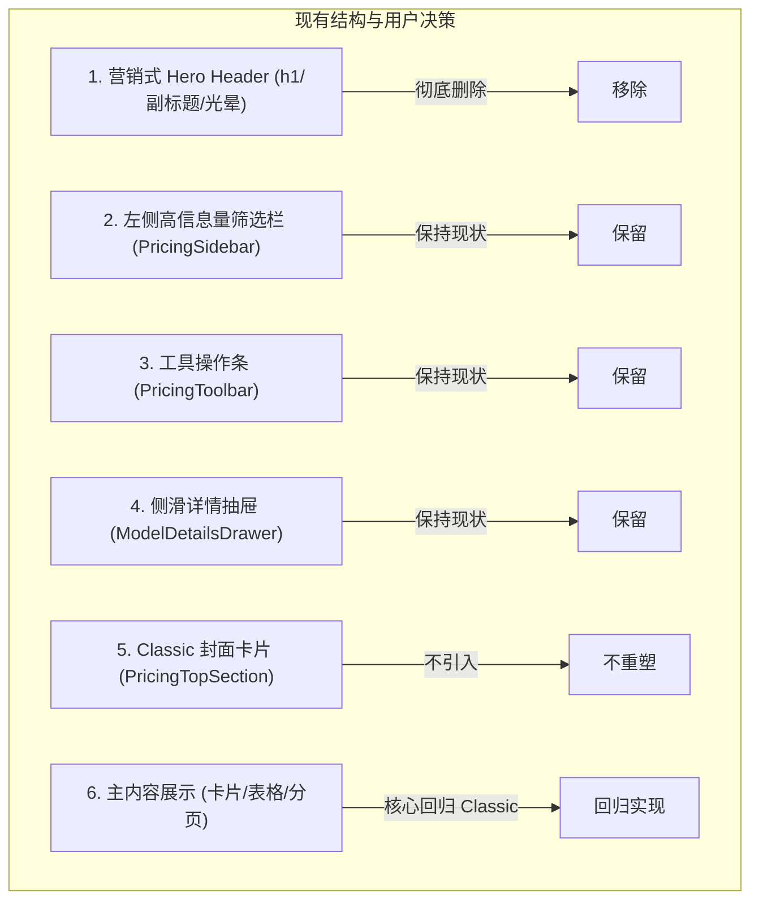

# 模型广场 (Pricing) Classic 回归计划

## 目标

按照用户决策，对模型广场页面（`/pricing`）进行定向重构与视觉回归：
1. **剥离居中营销式 Hero 大标题 Banner**，去除多余的大字标题、介绍段落及背景光晕装饰，收紧页面上部留白，恢复高效工作台形态；
2. **保留现有左侧高信息量筛选栏（`PricingSidebar`）**；
3. **保留现有操作工具栏（`PricingToolbar`，即 `div.bg-card.rounded-xl.border.p-3`）**；
4. **保留现有侧滑详情抽屉（`ModelDetailsDrawer`）**；
5. **不重塑旧版 Classic 的带封面卡片（`PricingTopSection`）**；
6. **核心回归主内容展现（卡片视图 `ModelCardGrid`/`ModelCard` 与表格视图 `PricingTable`）**：恢复 Classic 的整卡点击、大图标与紧凑价格层级、彩色标签组、右上角快捷复制以及分页机制。

---

## 边界与现状比对

### 现状比对与决策落点表

| 页面区块 | 现状 (新版) | Classic (旧版) | 本次执行策略 |
| :--- | :--- | :--- | :--- |
| **顶部 Banner** | 居中巨大 `<h1>模型广场</h1>`、统计文本、大背景渐变光晕 | 无居中营销 Banner，紧凑直入工作区 | **彻底删除** |
| **搜索框** | 挂载在被删除的居中 Banner 内部 | 挂载在操作工具条中 | **内联融入 `PricingToolbar`**，避免功能缺失 |
| **左侧筛选栏** | 现代抽屉折叠列表（供应商、分组、类型、端点、标签） | 类似结构的 5 折叠面板 | **保持现状不变** |
| **操作工具栏** | `div.bg-card.rounded-xl.border.p-3`（数量统计、Standard/Recharge、K/M、排序、视图切换） | 封面卡片下部的简单横条 | **保持现状不变** |
| **卡片视图 (Card)** | 图标偏小 (40px)、整卡不可点击、需点击底部小“详情 >”按钮、价格堆砌在复杂网格、一次性平铺全量模型 | **整卡点击打开抽屉**、**48px 大圆角图标**、模型名下直接紧凑价格、标签胶囊与计费类型分列底端、**分页浏览** | **回归 Classic 设计** |
| **表格视图 (Table)** | 宽列距表格 | 紧凑高密度数据表、点击整行打开抽屉 | **对齐紧凑层级与整行点击** |
| **详情抽屉** | `ModelDetailsDrawer` 包含参数、端点、图表、计费公式等 | `ModelDetailSideSheet` 包含类似信息 | **保持现状不变** |

---

## 详细回归方案（主内容展现）

### 1. 卡片视图（`ModelCard`）Classic 视觉重塑
- **整卡可点击**：
  - 点击卡片任意位置直接触发 `onModelClick(model.model_name)` 打开右侧抽屉；
  - 样式加入 `cursor-pointer transition-all duration-200 hover:shadow-lg !rounded-2xl border`；
  - 移除卡片底部突兀的 `Details >` 独立按钮。
- **头部（Header）经典层级**：
  - **左侧**：48×48 大图标（`w-12 h-12 rounded-2xl shadow-sm bg-muted/40`），包含供应商/模型专属 Lobe 图标或首字母大字 Avatar；
  - **中间**：模型名称（加粗、16px~18px、单行截断），模型名正下方直接呈现紧凑价格（如 `输入: $0.0015 / 1K | 输出: $0.002 / 1K` 或按次费用）；
  - **右上角**：快捷复制图标按钮（`<Copy />`，带 Toast 反馈，阻止事件冒泡 `e.stopPropagation()`）。
- **中部（Body）**：
  - 模型描述文本（2 行自然截断 `line-clamp-2 text-xs text-muted-foreground leading-relaxed`）。
- **底部（Footer / Tags）**：
  - **左侧**：计费类型胶囊（`按量计费` 紫色 / `按次计费` 青色）；
  - **右侧**：功能特性彩色胶囊（如 `视觉`、`代码`、`长上下文`、`深度思考`，最多显示 3 个，色彩映射对齐 Classic 的哈希取色或设计规范）。
- **分页控制**：
  - 在卡片网格底部引入分页条（支持 12/24/48 或 10/20/50 条切换），解决一次性渲染数百个模型导致的页面过度拉长与卡顿问题。

### 2. 表格视图（`PricingTable`）交互对齐
- 保留高密度列排布；
- 点击整行直接呼出右侧抽屉；
- 模型名称、供应商、计费类型胶囊、标签及价格列保持 Classic 的对齐美感与复制能力。

---

## 实现步骤

1. **改造页面容器与移除 Banner（`web/src/features/pricing/index.tsx`）**：
   - 彻底删除 `header.mx-auto.mb-5.max-w-3xl` 及背景渐变光晕 div；
   - 恢复 Classic 的视口卡片内滚结构：整页 `h-[100dvh] overflow-hidden`，顶部安全留白 `pt-20 sm:pb-6` 避开导航栏；
   - `PricingToolbar`（`class="bg-card rounded-xl border p-3"`）设为 `flex-shrink-0` 绝对不跟随滚动；
   - 内容卡片区（`pricing-view-container`）使用 `min-h-0 flex-1 overflow-y-auto` 独立滚动，杜绝侵入操作栏与头部导航。
2. **搜索框内联集成（`pricing-toolbar.tsx`）**：
   - 将原位于 Banner 中的搜索框无缝移入 `PricingToolbar` 左侧（位于模型数量前/后），保持工具栏单行紧凑。
3. **重塑模型卡片组件（`web/src/features/pricing/components/model-card.tsx`）**：
   - 调整为整卡可点击、大图标 48×48、顶部内联价格、底部左右标签分列，并移除“详情 >”按钮。
4. **卡片网格与分页（`model-card-grid.tsx`）**：
   - 引入前端分页逻辑，并渲染底部分页条。
5. **表格视图行交互（`pricing-table.tsx`）**：
   - 确保表格整行点击可唤起详情抽屉，列宽紧凑美观。
6. **自动化测试与质量校验**：
   - 调整并跑通 pricing 相关单元测试；
   - 执行 `bun run typecheck`、`oxlint` 及 `bun run build`。

---

## 进度与执行状态

- [x] 编写并确认 PLAN 文档。
- [x] 移除居中营销 Hero Banner 与渐变光晕，收紧页面顶部边距（`pt-4 sm:pt-6`）。
- [x] 搜索框平滑迁移至操作工具栏（`PricingToolbar` 内联左侧呈现）。
- [x] 重构 `ModelCard` 视觉层级（整卡点击可呼出抽屉、48×48 大图标、大字模型名、直接下挂紧凑价格与底部标签）。
- [x] 确认底部分页器（`ModelCardGrid` 与 `PricingTable` 均支持标准分页控制）及表格整行点击能力。
- [x] 验证自动化测试、类型检查、lint 与构建（通过 153 项单元测试、tsgo 0 报错、oxlint 0 警告、rsbuild 打包完成）。
